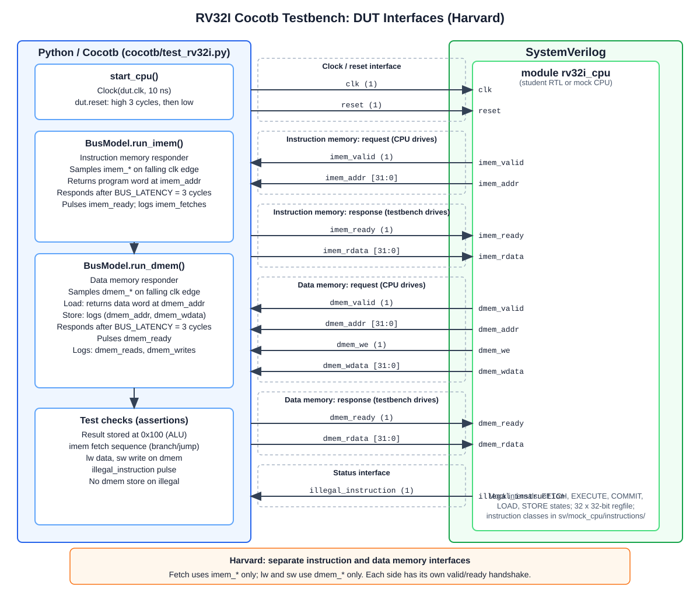

# RV32I Cocotb Testbench

A Cocotb testbench for developing and checking an RV32I Harvard-architecture
CPU instruction by instruction. It includes 28 supported-instruction tests
and one illegal-decode smoke test. Independent instruction- and data-memory
responders provide only the transactions needed by those tests; they do not
model a complete system or peripherals.

## Requirements

- Verilator
- Python 3 with the packages in [`cocotb/requirements.txt`](cocotb/requirements.txt):

```sh
python3 -m pip install -r cocotb/requirements.txt
```

Run all `make` commands from this folder.

## Folder layout

| Folder | Contents |
| --- | --- |
| `cocotb/` | Python testbench (`test_rv32i.py`), coverage/dashboard helpers, `pytest.ini`, `requirements.txt` |
| `sv/mock_cpu/` | Reference mock CPU used to run the testbench without student RTL: `mock_rv32i_cpu.sv`, `rv32i_pkg.sv`, `cpu_model.sv`, `instructions/`. Do not edit. |
| `diagrams/` | Testbench block diagram (draw.io and SVG) |
| `results/` | Generated reports and simulator build (git-ignored) |

## Testbench architecture



The Python/Cocotb side drives `clk` and `reset` and models independent
instruction- and data-memory responders; the SystemVerilog CPU is the design under test. The editable
diagram source is [diagrams/tb_architecture.drawio](diagrams/tb_architecture.drawio).

### Expected CPU: Harvard (separate instruction and data interfaces)

The CPU must expose **two independent memory interfaces**: `imem_*` for
instruction fetches only, and `dmem_*` for loads and stores only. Each has its
own valid/ready handshake and is served by its own Cocotb responder. A
von Neumann CPU with a single shared bus does not match this testbench.

### Required top-level ports

The top-level module must provide exactly these ports (default name
`rv32i_cpu`; the module can be built from any number of files):

| Port | Direction | Description |
| --- | --- | --- |
| `clk` | input, 1 bit | Clock |
| `reset` | input, 1 bit | Active-high asynchronous reset |
| `imem_valid` | output, 1 bit | CPU requests an instruction fetch |
| `imem_ready` | input, 1 bit | Instruction-memory response |
| `imem_addr` | output, 32 bits | Instruction fetch address |
| `imem_rdata` | input, 32 bits | Fetched instruction |
| `dmem_valid` | output, 1 bit | CPU requests a data transaction |
| `dmem_ready` | input, 1 bit | Data-memory response |
| `dmem_addr` | output, 32 bits | Load/store address |
| `dmem_we` | output, 1 bit | High for a store |
| `dmem_wdata` | output, 32 bits | Store data |
| `dmem_rdata` | input, 32 bits | Loaded data |
| `illegal_instruction` | output, 1 bit | One-cycle indication when an unsupported instruction is committed |

## Instructions tested

Each supported instruction has a Cocotb test. Links point to the corresponding
SystemVerilog instruction definition used by the mock CPU; `illegal` links to
the invalid-instruction implementation. Shared opcode and instruction-field
encodings are defined in [`rv32i_instruction.sv`](sv/mock_cpu/instructions/rv32i_instruction.sv).

| Category | Instruction | Definition |
| --- | --- | --- |
| Register ALU | `add` | [`rv32i_add.sv`](sv/mock_cpu/instructions/rv32i_add.sv) |
| Register ALU | `sub` | [`rv32i_sub.sv`](sv/mock_cpu/instructions/rv32i_sub.sv) |
| Register ALU | `and` | [`rv32i_and.sv`](sv/mock_cpu/instructions/rv32i_and.sv) |
| Register ALU | `or` | [`rv32i_or.sv`](sv/mock_cpu/instructions/rv32i_or.sv) |
| Register ALU | `xor` | [`rv32i_xor.sv`](sv/mock_cpu/instructions/rv32i_xor.sv) |
| Register ALU | `sll` | [`rv32i_sll.sv`](sv/mock_cpu/instructions/rv32i_sll.sv) |
| Register ALU | `srl` | [`rv32i_srl.sv`](sv/mock_cpu/instructions/rv32i_srl.sv) |
| Register ALU | `sra` | [`rv32i_sra.sv`](sv/mock_cpu/instructions/rv32i_sra.sv) |
| Register ALU | `slt` | [`rv32i_slt.sv`](sv/mock_cpu/instructions/rv32i_slt.sv) |
| Register ALU | `sltu` | [`rv32i_sltu.sv`](sv/mock_cpu/instructions/rv32i_sltu.sv) |
| Immediate ALU | `addi` | [`rv32i_addi.sv`](sv/mock_cpu/instructions/rv32i_addi.sv) |
| Immediate ALU | `andi` | [`rv32i_andi.sv`](sv/mock_cpu/instructions/rv32i_andi.sv) |
| Immediate ALU | `ori` | [`rv32i_ori.sv`](sv/mock_cpu/instructions/rv32i_ori.sv) |
| Immediate ALU | `xori` | [`rv32i_xori.sv`](sv/mock_cpu/instructions/rv32i_xori.sv) |
| Immediate ALU | `slli` | [`rv32i_slli.sv`](sv/mock_cpu/instructions/rv32i_slli.sv) |
| Immediate ALU | `srli` | [`rv32i_srli.sv`](sv/mock_cpu/instructions/rv32i_srli.sv) |
| Immediate ALU | `srai` | [`rv32i_srai.sv`](sv/mock_cpu/instructions/rv32i_srai.sv) |
| Immediate ALU | `slti` | [`rv32i_slti.sv`](sv/mock_cpu/instructions/rv32i_slti.sv) |
| Immediate ALU | `sltiu` | [`rv32i_sltiu.sv`](sv/mock_cpu/instructions/rv32i_sltiu.sv) |
| Branch | `beq` | [`rv32i_beq.sv`](sv/mock_cpu/instructions/rv32i_beq.sv) |
| Branch | `bne` | [`rv32i_bne.sv`](sv/mock_cpu/instructions/rv32i_bne.sv) |
| Branch | `blt` | [`rv32i_blt.sv`](sv/mock_cpu/instructions/rv32i_blt.sv) |
| Branch | `bge` | [`rv32i_bge.sv`](sv/mock_cpu/instructions/rv32i_bge.sv) |
| Jump | `jal` | [`rv32i_jal.sv`](sv/mock_cpu/instructions/rv32i_jal.sv) |
| Jump | `jalr` | [`rv32i_jalr.sv`](sv/mock_cpu/instructions/rv32i_jalr.sv) |
| Upper immediate | `lui` | [`rv32i_lui.sv`](sv/mock_cpu/instructions/rv32i_lui.sv) |
| Memory | `lw` | [`rv32i_lw.sv`](sv/mock_cpu/instructions/rv32i_lw.sv) |
| Memory | `sw` | [`rv32i_sw.sv`](sv/mock_cpu/instructions/rv32i_sw.sv) |
| Invalid decode smoke test | `illegal` | [`rv32i_invalid.sv`](sv/mock_cpu/instructions/rv32i_invalid.sv) |

Each test runs a short program, supplies responses through the Cocotb
instruction/data memory models, and checks the computed result, control-flow
address, or data-memory transaction.

The illegal-encoding test expects the `illegal_instruction` output pulse and
checks that the invalid instruction causes no data-memory store. This is a smoke test
for invalid decode and side-effect suppression, not full architectural trap
verification.

## Running the tests

Run the complete test set against the included mock CPU:

```sh
make test_cpu
```

The mock CPU is behavioral, not synthesizable RTL. It includes a configurable
execution delay (`EXEC_LATENCY`, default 2 cycles); each Cocotb memory responder adds
response latency (`BUS_LATENCY` in [`cocotb/test_rv32i.py`](cocotb/test_rv32i.py)).

`INSTRUCTIONS` accepts a single instruction, a comma-separated list, or one or
more instruction groups:

```sh
# Run exactly one instruction
make test_cpu INSTRUCTIONS=add

# Run a small list
make test_cpu INSTRUCTIONS=add,sub,addi

# Run a whole group
make test_cpu INSTRUCTIONS=alu

# Combine a group and individual instruction
make test_cpu INSTRUCTIONS=branch,lw
```

Available instruction groups are `alu`, `branch`, `jump`, `upper`, and
`memory`. The default is `all`. Each run replaces the reports in `results/`;
subset coverage is reported against the full instruction list.

## Testing your own CPU

The mock CPU in `sv/mock_cpu/` is only a reference. Keep your CPU in its own
folder (for example `sv/student/`) and do not edit `sv/mock_cpu/`. Your CPU
can be split across as many files as you like. Select it with one of the
options below; `TOPLEVEL` is the name of your top-level module (default
`rv32i_cpu`).

### Option 1: file list (recommended for several files)

List your files in a Verilator file list, one per line. Relative paths are
resolved relative to the list file. Put package files before the files that
use them, and add include directories with `+incdir+`:

```text
# sv/student/files.f
+incdir+.
rv32i_defs_pkg.sv
alu.sv
decoder.sv
rv32i_cpu.sv
```

```sh
make test_cpu SV_FILELIST=sv/student/files.f TOPLEVEL=rv32i_cpu
```

### Option 2: list files on the command line

```sh
make test_cpu \
  TOPLEVEL=rv32i_cpu \
  VERILOG_SOURCES="sv/student/rv32i_defs_pkg.sv sv/student/alu.sv sv/student/rv32i_cpu.sv" \
  SV_INCDIRS="sv/student"
```

Notes for multi-file designs:

- Packages must come before any file that imports them; other modules can be
  in any order.
- `SV_INCDIRS` (space-separated) sets include directories for `` `include ``.
- Paths must be absolute or relative to this folder (Option 2) or to the list
  file (Option 1).
- Every run rebuilds the simulator, so edited files are always picked up.
- Only `TOPLEVEL` and the port list above must match; internal module names
  and file organization are up to you.

## Results and coverage

Every run writes all generated outputs to `results/`:

- `results/dashboard_cpu.html` — pass/fail results, with an instruction coverage
  summary.
- `results/coverage.json` — selected instructions, successfully covered
  instruction bins, and hit counts.
- `results/results.xml` — raw Cocotb test results.
- `results/sim_build/` — generated simulator build files.

Instruction functional coverage is instruction-bin coverage: a bin is counted
only after its Cocotb test completes successfully. When a full run passes, the
dashboard should report **29/29 (100%)** instruction/decode bins (28
instructions plus the illegal-decode smoke test). This provides evidence that
every listed test passed in that run; it does not prove all operand values,
corner cases, RTL code paths, line coverage, toggle coverage, or whole-system
integration.

For a review or submission, keep `results/dashboard_cpu.html` and
`results/coverage.json` together as the run artifacts. The HTML dashboard gives
a readable summary; the JSON file records the exact covered bins and
per-instruction hit counts. For a partial development run, these artifacts
make clear which tests were selected and which remain uncovered.

Remove generated reports and build/cache files with:

```sh
make clean
```

## References

**RV32I**

- A. Waterman, K. Asanović (eds.), *The RISC-V Instruction Set Manual, Volume I: Unprivileged ISA* (RV32I base integer ISA, chapter 2). Ratified specifications: <https://riscv.org/specifications/ratified/>; source: <https://github.com/riscv/riscv-isa-manual>
- D. Patterson, A. Waterman, *The RISC-V Reader: An Open Architecture Atlas*, Strawberry Canyon, 2017.

**Harvard architecture and CPU design**

- D. Patterson, J. Hennessy, *Computer Organization and Design: RISC-V Edition — The Hardware/Software Interface*, 2nd ed., Morgan Kaufmann, 2020. Separate instruction and data memories in the single-cycle and pipelined datapaths.
- S. Harris, D. Harris, *Digital Design and Computer Architecture: RISC-V Edition*, Morgan Kaufmann, 2022. SystemVerilog implementation of an RV32I processor.
- J. Hennessy, D. Patterson, *Computer Architecture: A Quantitative Approach*, 6th ed., Morgan Kaufmann, 2017. Memory hierarchy, including split instruction and data caches.
